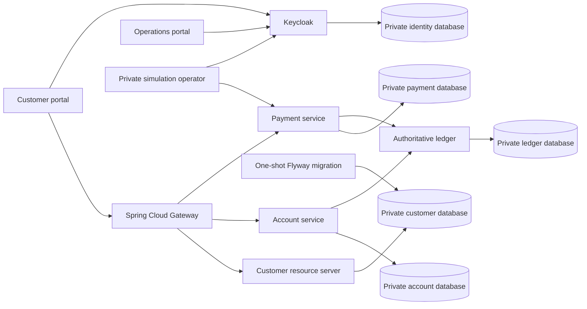

# FinCore

Distributed digital banking and payment processing **simulation**, using synthetic customers and simulated money exclusively.

**Status: Phase 3 ? owned accounts and recoverable simulated payments.** Customer onboarding, account ownership/provisioning/restrictions, authoritative ledger balances/history, signed actor authorization, risk-policy decisions and durable payment/reversal recovery are implemented. The React workspaces remain authentication shells; customer banking screens are Phase 4. See the [Phase 3 verification report](docs/verification/phase-3.md) for actual test results and limitations.

GitHub's canonical repository is `ABDOUUisHERE/FinCore-Bank`. Local Docker validation is recorded in the [workstation verification report](docs/verification/local-docker-2026-10-23.md).

## Quick start

Requires Git, Python 3.10+ and a running Docker Engine with Compose v2.

```sh
git clone https://github.com/ABDOUUisHERE/FinCore-Bank.git
cd FinCore-Bank
git switch main
python scripts/bootstrap-local.py
docker compose up --build -d --wait --wait-timeout 300
docker compose run --rm ledger-check
```

Open **http://localhost:5173** for the customer workspace or **http://localhost:5174** for operations. Sign in as `customer.demo` or `admin.demo` using their generated passwords in ignored `.local/credentials.json`. No shared passwords are committed. Use `localhost` exactly for OIDC redirect matching. [Setup and troubleshooting](docs/deployment/local-setup.md) explains startup, migration credentials, native development and persistent data.

Stop with `docker compose down`. The named PostgreSQL volume survives normal shutdown. This loopback-only environment uses simulated identities and development HTTP; external deployment is outside this milestone.

## Incremental architecture


[Mobile capture](docs/evidence/foundation-mobile.png). These show the anonymous foundation UI; banking features are explicitly marked as upcoming. See the [verification report](docs/verification/phase-1.md) for capture environment and container test evidence.



Both Gateway and Customer independently validate signed JWTs, issuer, audience, expiry and roles. Customer APIs derive identity from the token; administrator privileges do not imply customer privileges. Portal tokens stay in memory. The operations shell currently has no operational data APIs. [API contract](contracts/openapi/customer-v1.yaml): `GET /api/v1/customers/me` returns the authorized subject and recognized roles only.

## Architecture review

The architecture was approved before implementation. The [Phase 0 review](docs/fincore/README.md) is the historical proposal. [Phase 1 verification](docs/verification/phase-1.md) preserves foundation evidence; [Phase 2 verification](docs/verification/phase-2.md) records the ledger milestone, actual results and limits. [Account/Payment API](contracts/openapi/business-v1.yaml), [Ledger API](contracts/openapi/ledger-v1.yaml) and [write-boundary ADR](docs/fincore/adr/0005-ledger-write-boundary.md) describe its contract and guarantees.

| Document | Contents |
| --- | --- |
| [Master specification](docs/fincore/specification.md) | Original supplied requirements, preserved verbatim |
| [Repository assessment](docs/fincore/repository-assessment.md) | Actual starting point, tooling and constraints |
| [Architecture proposal](docs/fincore/architecture.md) | Service boundaries, deployment model and Mermaid diagrams |
| [Financial core](docs/fincore/financial-core.md) | Accounting, schema, concurrency, idempotency and recovery |
| [API and event contracts](docs/fincore/contracts.md) | Proposed requests, errors and event delivery |
| [Security and risks](docs/fincore/security.md) | Authorization, transfer threat model and trade-offs |
| [Roadmap](docs/fincore/roadmap.md) | Prioritized milestones, exact Phase 1 scope and validation gates |
| [Architecture decisions](docs/fincore/adr/) | Accepted decisions and implementation refinements |

## Proposed stack

Java 21, Spring Boot 3.5.16, Spring Cloud 2025.0.3, Keycloak 26.8.1, PostgreSQL 17.11, React 19.3.1, TypeScript, Vite and Tailwind CSS. Dependencies are locked. Kafka, Redis, full observability and Kubernetes are introduced when their milestones need them.

The ledger owns all financial postings. Customer and account balance screens are read models; payment success requires authoritative ledger confirmation. Services are independently deployable and added incrementally, rather than creating eleven empty implementations.

## Running and testing

```sh
./mvnw -B -ntp verify
npm ci
npm run typecheck
npm run lint
npm test
npm run build
npm audit --audit-level=high
```

Use `mvnw.cmd` on Windows. Maven integration tests use real PostgreSQL through Docker; `-DskipITs` explicitly omits them. Once the stack is running, `docker compose run --rm ledger-check` tests the private financial API with a real technical token. `python scripts/check-foundation.py` and `npm run test:e2e` check private Customer rejection and browser PKCE login (install Chromium with `npx playwright install chromium`). The browser suite also completes a two-customer financial API journey using real PKCE tokens and the private check runner. See the [test guide](docs/testing.md) and [current verification](docs/verification/phase-3.md) for actual outcomes. GitHub Actions runs backend, frontend and Compose/browser/ledger checks; no automatic deployment is configured.

Do not use the Core5G simulator from the previously selected workspace as FinCore runtime or evidence: it is a separate project and repository.

## GitHub workflow

Use a dedicated branch for each milestone and cohesive Conventional Commits. Push reviewed changes to this repository, open a pull request when requested, and retain verification evidence with the milestone. Architecture approval is required before application implementation. Push authorization does not imply permission to merge or deploy.

