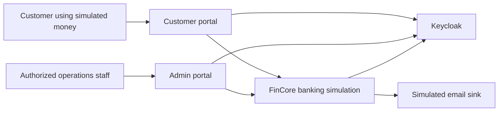
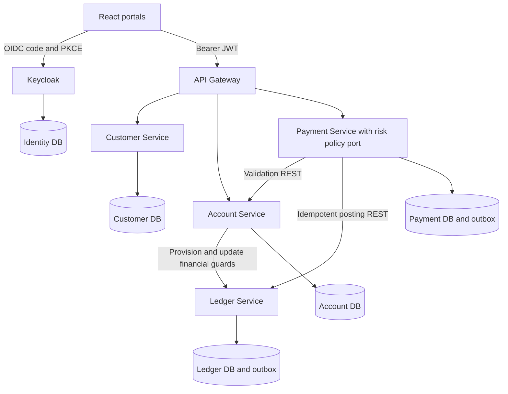
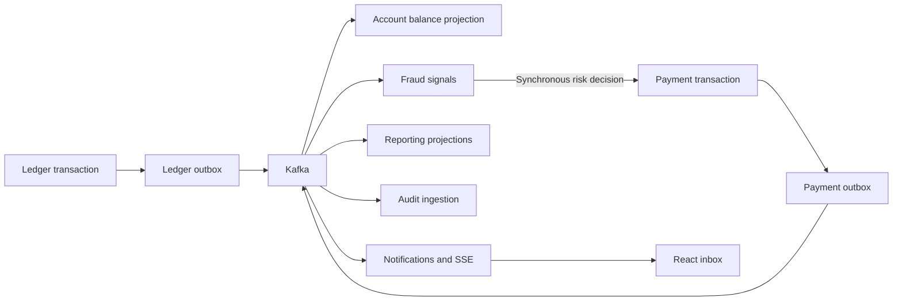
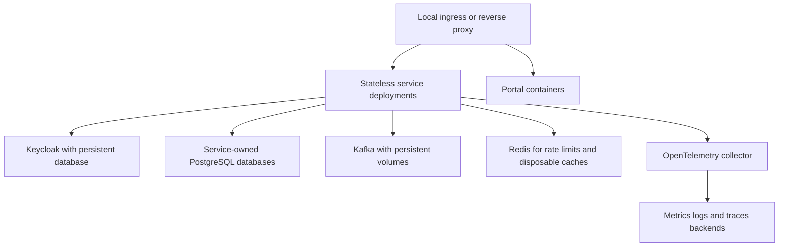

# Proposed system architecture

Status: proposed, pending architecture approval. All components below are planned unless explicitly described as an existing external tool.

## Deployment decision

Use independent Spring Boot services with private data ownership. A modular monolith would reduce initial resource usage and allow local payment/ledger transactions, but would defer the distributed recovery behavior central to this specification. Prefer a small number of real services introduced gradually: gateway/customer in Phase 1, ledger in Phase 2, account/payment in Phase 3. Do not create all eleven service skeletons now.

Each service uses an internal hexagonal layout: `domain` (plain Java rules), `application` (use cases and ports), `adapter/in/web`, `adapter/out/persistence`, and `configuration`. Dependencies point inward. Each deployable has its own Maven module and tests; shared libraries contain technical event/error contracts only, never shared entities, mutable business repositories or balance logic. Use JDBC and explicit SQL for the ledger so locks and transaction boundaries remain visible; JPA may be used outside the ledger after a justified choice.

Use Java 21 and a Spring Boot 3.x BOM with a compatible Spring Cloud BOM, verified and pinned in Phase 1. Use Maven Wrapper, Flyway and Spring Security resource servers. React applications use Vite, TypeScript, Tailwind, Router, TanStack Query, React Hook Form, Zod and Recharts as features require them. Avoid floating dependency/container tags.

## Service responsibility matrix

| Context / deployable | Responsibilities and owned data | Financial authority / introduction |
| --- | --- | --- |
| Keycloak | Identities, credentials, roles, MFA, sessions; own database | Authentication only; Phase 1 |
| API Gateway | Routing, JWT validation, limits, correlation IDs, CORS, size bounds, errors | No financial state; Phase 1 |
| Customer | Profile, preferences, synthetic KYC, lifecycle, OIDC subject mapping | Customer data only; Phase 1 shell, Phase 3 onboarding |
| Account | Account metadata, owner relationships, restrictions, closure workflow, balance display projection | No independent balance mutation; Phase 3 |
| Ledger | Chart of accounts, spending guards, journals, postings, atomic balance cache, holds, financial operations and durable idempotency | Sole financial authority; Phase 2 |
| Payment | Commands, validation, risk orchestration, state machine, recovery and reversals | Only ledger-confirmed completion; Phase 3 |
| Beneficiary | Verified synthetic destinations, confirmation, enable/disable and history | No posting rights; customer UI phase |
| Fraud | Versioned rules, synchronous assessments, velocity state, alerts and investigations | ALLOW/REVIEW/BLOCK before posting; Phase 6 extraction |
| Notification | Preferences, delivery attempts, synthetic email, inbox and SSE | Event-driven projection; Phase 5 |
| Reporting | Summaries, reconciliation jobs, CSV/PDF, statement snapshots | Ledger-backed financial totals; projections labeled; Phase 7 |
| Audit | Append-only security/operational records, investigations and access/retention policy | No power to edit financial records; Phase 8 dedicated service |

Audit metadata and a minimal risk gate are required in earlier money-moving milestones even before the full services exist. Phase 3 uses a versioned local risk-policy port with deterministic limits; it is extracted into synchronous Fraud Service assessment in Phase 6. An unavailable required risk check fails closed. Full fraud coverage is not claimed until Phase 6. Operational incidents belong to the administrative workflow, backed by audit records; no extra incident microservice is initially needed.

Wallets initially mean customer account groupings/read views. They are not a second balance store. Separate wallet products or partial card settlement require a later ADR. Synthetic cards use nonfunctional identifiers; no real PAN/CVV or bank/provider integration is permitted.

## System context

## Initial financial deployment (Phases 1–3)

REST is the initial cross-service protocol: easy to inspect, contract-test and exercise from a portfolio demo. gRPC is deferred until a measured need justifies another tooling surface. No HTTP calls occur inside a ledger database transaction. Internal endpoints are not gateway-routed to browsers; service credentials and explicit actor authorization are mandatory.

## Event and read-model evolution

The ledger emits financial facts; Payment emits lifecycle facts after ledger confirmation. Consumers never book money from a payment event. Kafka outage delays projections and notifications; durable outbox rows are retained. Capacity limits may reject new requests with a retryable error before creating intent if backlog safety thresholds are exceeded. Events are at least once; duplicates and out-of-order delivery must be safe.

## Data ownership and restriction consistency

Use one PostgreSQL server locally with **separate logical databases and logins** per service, including Keycloak. No cross-service joins, foreign keys or grants. Production placement can split servers without changing ownership. Services own their migrations and backups.

The Account Service owns the product lifecycle; the Ledger owns the financial spending guard (currency, customer subject entitlement, freeze/closure permission and guard revision). Account creation is PENDING until idempotent ledger provisioning is confirmed. A restriction is not acknowledged as financially effective until the ledger guard update commits. Transfers and guard updates lock the same ledger rows; a posting that commits before a freeze is ordered before that freeze. Closure additionally requires zero balance and no holds under those locks. Account displays may lag; they must show a pending workflow rather than assert a freeze that has not become effective. Concurrent metadata changes use version checks.

This protocol intentionally avoids treating a stale remote account validation as sufficient authorization. Ledger transfer commands carry validated actor identity; the ledger independently checks its financial entitlement and guards. The guard is not a second customer-profile or product-metadata owner. See [financial core](financial-core.md).

## Observability and deployment target

Every service exposes restricted Actuator health and metrics, structured JSON logs and propagated trace/correlation IDs without payloads or tokens. Introduce Micrometer and tracing hooks early; add Prometheus/Grafana, OpenTelemetry collector, Loki and Tempo/Jaeger when operational dashboards are implemented. Gateway is the single business ingress; browser redirects also need a reachable Keycloak issuer. Local ports bind to loopback, and optional profiles avoid starting the full observability stack unnecessarily.

Kubernetes Phase 9 adds probes, resources, network policies, non-root security contexts, ingress/TLS and justified autoscaling. Stateful databases and Kafka need appropriate operators or documented local single-node storage, backups and restore tests; a local demo does not establish high availability. Redis is never a ledger, distributed money lock or sole idempotency store.
