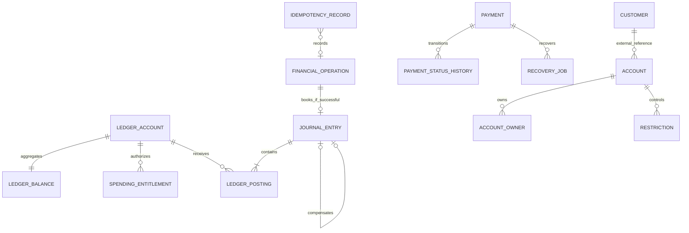
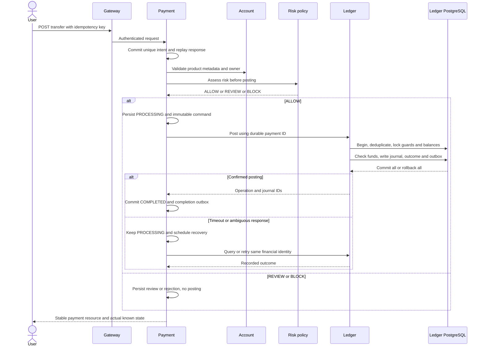
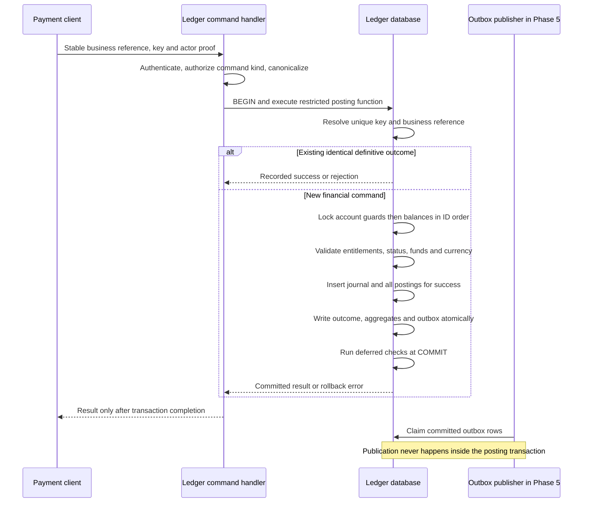

# Financial core proposal

Status: proposed design, not implemented or tested.

## Money and chart of accounts

Use `Money(BigDecimal amount, Currency currency)`. Initial supported currencies are MAD, EUR and USD, each with scale 2. Parse JSON amounts from decimal strings, reject exponent notation at the API boundary, require positive nonzero command amounts, bound values to `NUMERIC(20,2)`, and reject precision loss using `RoundingMode.UNNECESSARY`. `100`, `100.0` and `100.00` normalize to the same value and request fingerprint. Never construct money from `double` or silently round. Currency mismatch, unknown currencies and FX transfers are rejected. Adding another currency requires its precision and schema migration, not merely a UI option. No currency totals are combined.

| Ledger account | Normal side | Effect of debit | Effect of credit |
| --- | --- | --- | --- |
| Customer deposit liability | CREDIT | Reduces customer funds | Increases customer funds |
| Simulated settlement asset | DEBIT | Increases simulated funding asset | Reduces simulated funding asset |
| Simulated merchant liability | CREDIT | Reduces merchant entitlement | Increases merchant entitlement |

Examples, each in one currency and one atomic journal:

- Internal transfer 100.00 MAD: debit sender liability 100.00; credit receiver liability 100.00.
- Simulated deposit 100.00 MAD: debit simulated settlement asset 100.00; credit customer liability 100.00.
- Simulated withdrawal 100.00 MAD: debit customer liability 100.00; credit simulated settlement asset 100.00.
- Merchant payment: debit customer liability; credit simulated merchant liability.
- Full refund/reversal: create a new journal with the original sides inverted, linked to the original journal. No original posting changes.

Funding APIs are restricted simulation tooling with explicit scope, limits and audit; arbitrary customers cannot mint unlimited funds. There are no real settlement networks. Overdraft is disabled for customer and merchant liability accounts. Settlement behavior must be documented separately; demo funding can increase the synthetic asset through balanced deposits. A settlement withdrawal cannot reduce that asset below its configured policy.

## Financial truth and invariants

Immutable committed journals and postings are the source of booked balances. A ledger-local `ledger_balance` row is a transactionally maintained, reconstructable aggregate and lock target; it is never independently writable by Account, Payment, Redis or a projection consumer. Debit-normal accounts use debits minus credits, credit-normal accounts use credits minus debits.

Initially there are no reservations: available equals booked. When card holds arrive, available equals booked minus active reservations on customer liabilities. Hold placement, release, expiration and capture must use the same ledger locks and idempotency discipline. Never represent a risk-review payment as a debit or hold unless a dedicated reservation command has succeeded.

Every committed journal must contain at least two positive postings, matching account and journal currency, with equal debit/credit sums. Journal total equals the sum of debit postings. A business operation has one durable financial identity. Journals, postings and definitive financial operation outcomes cannot be updated, deleted or appended to after commit. Corrections use compensating journals. Mutable workflow state, aggregate balances, holds and outbox delivery metadata are explicitly separate.

## Proposed schema

Tables below are design descriptions, not executable migrations. All identifiers are UUIDs unless stated; timestamps are `timestamptz` in UTC. Decimal sums use exact PostgreSQL `numeric` arithmetic.

| Database.table | Important columns | Constraints / access |
| --- | --- | --- |
| customer.customer | id, oidc_subject, status, version | Unique subject; no stored passwords |
| account.account | id, customer_id, currency, status, guard_revision, version | Customer ID is an external reference |
| account.account_owner | account_id, customer_subject, relationship | Unique relationship; local FK to account |
| account.restriction | id, account_id, kind, workflow_status, revision | Pending/effective guard workflow |
| account.balance_projection | account_id, currency, booked, available, ledger_version, observed_at | Derived only; label freshness |
| ledger.ledger_account | id, external_account_id, currency, type, normal_side, status, guard_revision | Unique external reference/currency; valid type/normal-side pair |
| ledger.spending_entitlement | ledger_account_id, actor_subject, permission, revision | Local FK; only controlled provisioning may change |
| ledger.ledger_balance | account_id, currency, booked, reserved, version | PK/FK to ledger account; zero initial balance; reserved nonnegative |
| ledger.financial_operation | id, issuer_service, business_reference, kind, fingerprint, outcome_kind, response_code, journal_id, created_at | Unique issuer/reference; immutable definitive success or rejection; journal required only for success |
| ledger.journal_entry | id, operation_id, currency, total, posted_at, correlation_id, reversal_of | Unique operation; total positive; posted-only records; unique non-null reversal_of for full reversal |
| ledger.ledger_posting | id, journal_id, account_id, currency, direction, amount, sequence | Positive amount; DEBIT/CREDIT; unique journal/sequence; composite FKs enforce currency |
| ledger.idempotency_record | caller_id, operation_kind, key, fingerprint, outcome_kind, response_code, response_body, operation_id, created_at | Unique caller/kind/key; outcome linked atomically; financial key identities retained |
| ledger.reservation (later) | id, account_id, amount, currency, status, expires_at, version | Introduced only with hold/capture state machine |
| payment.payment | id, actor_subject, source_id, destination_id, amount, currency, kind, status, version, risk_reference, journal_id, created_at | Positive amount; unique confirmed journal reference; external ledger ID, no cross-DB FK |
| payment.payment_status_history | id, payment_id, old_status, new_status, reason, occurred_at | Append-only transitions; local FK |
| payment.idempotency_record | actor_subject, operation_kind, key, fingerprint, payment_id, initial_response, created_at | Unique actor/kind/key; references durable payment intent |
| payment.recovery_job | payment_id, lease_until, lease_owner, next_attempt_at, attempts | Durable leases; one worker per lease; stale workers use fencing/version checks |
| each producer.outbox_event | event_id, aggregate_id, aggregate_version, type, schema_version, payload, occurred_at, published_at, attempts, lease_until | Written with business transaction; no cross-service shared outbox |
| each consumer.processed_event | consumer_name, event_id, processed_at | Unique consumer/event; insert with local side effect |

Each service also owns its migration history. `ledger.` and `payment.` above denote owners, not permission to place all tables in a shared schema. No database FK crosses a service boundary. PostingBatch is initially a command grouping one journal, not an unnecessary separate batch table; multi-journal batches need a later atomicity/size decision.

The CUSTOMER–ACCOUNT edge is conceptual; no cross-database FK exists. Payment stores external journal/account references, not ledger relationships enforced by shared SQL.

## Database enforcement and write surface

Expose a tightly scoped database posting function to the runtime role. The migration owner owns tables/functions; runtime is neither owner nor superuser and cannot alter triggers, truncate tables or write postings/balances directly. Functions use fixed search paths and explicit grants. A separate provisioning function creates zero-balance accounts; a restriction function updates financial guards under the same account locks used by posting.

The posting function performs fingerprint/idempotency resolution, locks, guard checks, insertions, balance updates and outbox writes in one transaction. Application validation provides useful errors; SQL constraints and deferred constraint triggers provide independent protection. A `CHECK` cannot enforce an aggregate equality across posting rows.

At commit, deferred constraint triggers on both new journals and new postings verify count, per-currency balance, currency consistency and journal totals. Triggering on journal insertion also rejects an empty journal. Immediate guards reject journal/posting update/delete and any posting insert targeting a journal from an earlier transaction; use an owning transaction marker set internally by the posting function, never a caller-supplied flag. The function must reject a second append to an already finalized journal even within the same transaction. Runtime permissions prevent bypass through direct DML; tests must explicitly exercise inserts, updates, deletes and truncate denial with the runtime role. The ledger aggregate is updated only by these controlled functions and independently reconciled from immutable postings.

This is an application/runtime immutability boundary, not protection from a malicious database superuser. Backup integrity, migration review and audit remain necessary. PostgreSQL supports deferred constraint triggers at transaction end; see [CREATE TRIGGER](https://www.postgresql.org/docs/current/sql-createtrigger.html).

## Concurrency protocol

1. Begin a short PostgreSQL transaction at READ COMMITTED. Resolve the unique idempotency record using insert-on-conflict and lock its durable outcome; never check then insert without uniqueness protection. A conflicting concurrent insert waits for the first transaction. If it rolls back, the second can proceed.
2. For a new request, lock all affected ledger account/guard rows in ascending immutable account ID order, then balance rows in the same order. Provisioning, holds, restrictions and reversals follow this exact order. Reversal also locks the original operation before account rows; all reversal paths share that ordering.
3. Revalidate actor entitlements, guard revisions, effective statuses, currency, amount and limits under locks. Compute deltas for all postings per account before testing available funds, including repeated appearances of the same account. Reject self-transfers initially. Use ledger-owned rows for financial authorization, not the Account display projection.
4. Reject any resulting prohibited negative balance or reservation violation. Per-transaction and daily amount limits are ledger-owned locked counters when required, not a race-prone preflight sum in Payment. Risk velocity is a separate synchronous Fraud reservation/decision protocol when introduced.
5. For success, insert the complete immutable operation/journal/posting set, update aggregates and versions, record the outcome, and insert `fincore.ledger.journal.posted.v1` into the outbox. For expected rejection, commit only the definitive operation outcome and idempotency mapping, without a journal or financial event. Deferred invariants run at commit. Either all intended changes persist or none do.
6. Return only after commit. Lock/deadlock/serialization timeouts cause bounded retries of the entire transaction with the same financial identity; an ambiguous commit is resolved by lookup, not by issuing a fresh operation.

Example: balance 150.00, two concurrent debits of 100.00. Both require the same lock. The first commits balance 50.00. The second reads that committed balance after acquiring the lock and returns insufficient funds. A service-local Java mutex cannot provide this protection across replicas. PostgreSQL row-lock behavior and consistent lock ordering are described in its [locking documentation](https://www.postgresql.org/docs/current/explicit-locking.html).

## Idempotency and payment recovery

Public idempotency scope is `(authenticated subject, operation kind, key)`; internal ledger scope is `(authenticated service client, operation kind, key)`. Hash a canonical, versioned payload including actor, kind, immutable source/destination IDs, normalized amount/currency and reference. Exclude trace IDs and request timestamps. Bound keys and payload sizes. Same key with a different fingerprint is HTTP 409; same key with the same payload returns the original resource and recorded outcome. Authentication and ownership checks still apply on replay.

Payment first commits its intent, idempotency link and history before calling Ledger. Use its durable payment UUID as ledger business reference and internal idempotency key. Persist the evaluated command and risk reference before posting. A ledger timeout keeps the payment PROCESSING; it is not proof of failure. A durable recovery worker queries the operation by issuer/reference and retries the same command/key only if no committed result exists. A concurrent original command and retry converge through the ledger uniqueness constraint. A different payload for the same business reference fails even if someone supplies a new transport idempotency key.

If Ledger committed but Payment crashed, recovery finds the journal and commits COMPLETED with a payment completion outbox event. If the financial transaction rolled back, retry can safely post once. Only a recorded definitive rejection yields FAILED/REJECTED; never replace an uncertain operation with a fresh UUID. After bounded foreground retries, retain pending state and durable scheduled reconciliation; exhausted recovery becomes an operational incident, not a guessed failure or automatic compensation.

Replays of an initially asynchronous request return its recorded acceptance envelope and stable payment ID; `GET` returns current status. Do not mutate the stored acceptance response into a misleading final result. Ledger outcomes are atomic. Expected ledger business rejection is recorded without postings; retrying that same key returns that rejection even if funds later change. The unique issuer/business-reference record also preserves rejections across different transport keys. Transient failures before commit create no false terminal outcome.

Financial operation identities, payload hashes and durable outcomes are retained for the lifetime of the simulated financial dataset. They must never expire through a Redis TTL. Large nonfinancial response payloads may be archived, but uniqueness tombstones and resource references remain recoverable. Retention is a project decision to revisit with privacy and storage requirements before any broader deployment.

## Transfer sequence

Risk review does not reserve funds initially. Approval requires privileged audit and fresh ownership/funds/risk checks, using the same payment identity. Cancel is allowed only before PROCESSING, protected by a status compare-and-set. Once processing has begun, resolve the original operation before deciding whether reversal is possible.

## Ledger posting sequence

## Reversals and reconciliation

Initial reversals are full and unique per original journal. An authorized operation creates compensating postings and must obey funds/guard rules for the account being debited. If the recipient already spent the money, the reversal fails or requires a separately approved operational workflow; the simulator must not silently overdraw it. `REVERSAL_PENDING` is a Payment workflow state, not permission to edit the original entry. If reversal fails definitively, return to COMPLETED with an audited failure reason; the original payment remains effective. Refund commands that compensate the same full payment share the same reversal uniqueness boundary.

Reconciliation compares posting-derived balances against ledger-local aggregates at a consistent snapshot, verifies journal equality per currency and checks confirmed payment references against ledger facts through owner APIs. Account projections are checked by ledger version, not by assuming synchronous delivery. Discrepancies create incidents and reports; never patch historical postings to make a report green. Recovery leases make worker claims exclusive, while ledger identities preserve correctness even if a lease expires during a request.
