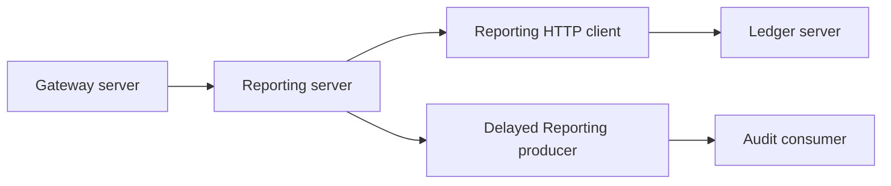

# Phase 8 lot 11 — collected Reporting traces

Accepted application source `1f65edb1a7012da8e2294b30204307af37eb1670`. Phase 8 remains incomplete. Main integration is recorded separately after its independent checks. [Machine-readable checks](../evidence/phase-8-reporting-tracing-checks.json) and the [collected native graph](../evidence/phase-8-reporting-trace-graph.json) retain technical IDs and closed metadata only.

Gateway and the servlet modules create bounded server spans; Reporting forwards client context to Ledger. A new nullable Reporting delivery-origin column captures the current request context in the same independent receipt transaction. Scheduled publication restores that ended context, adds a fresh producer attempt in a Kafka header and leaves the immutable body/key unchanged. Audit consumes under the actual producer attempt. Context is diagnostic, never actor identity or authorization. Legacy deliveries receive no fabricated origin; other owners do not opt into trace-origin delivery SQL.

The actual stored graph proves each edge and that the producer starts after the collected owner request ended. The test pauses publication, waits for that ended HTTP span to be stored, then restores the source privilege. Exact central body digests and original source bytes still match. The [operation and upgrade contract](../deployment/reporting-tracing-phase-8.md) defines the four-module scope, strict context profile, closed fields, three-second local receipt transaction and best-effort collector limits.

| Check | Measured result |
| --- | --- |
| Backend | 354 Java cases / 70 classes; no failures, errors or skips |
| Frontend | 64 cases / 13 files; types, lint, both builds and severity gate pass |
| Fresh Compose | 15 hosted PKCE browser journeys, four owner storage/replay/redaction probes, producer isolation, Ledger smoke and Kafka ACL/DLQ/replay pass |
| Native Java | 33 unique cases / 9 classes: invocations of 9 and 29 cases share 5; strict/duplicate/unsampled context, Reactor/servlet scope, typed consumer restoration, real PostgreSQL migration/rollback/lost-ack and original Reporting regressions |
| Native tracing journey | Stored four-module graph and exact parentage; actual delayed Kafka/Audit delivery; collector-offline HTTP/central receipt success; collected Ledger failure and recovery; ambiguous context isolation and privacy pass |
| Native audit regressions | All four owner direct denial, replay/quarantine/storage recovery and producer isolation pass with privileges restored |
| Preserved V2→V3 upgrade | Original business/grant rows, four owner envelopes and original delivery fields unchanged before test traffic; original environment/realm/credential bytes preserved; zero historical trace origins |
| Final native runtime | 17 running containers: 16 Docker healthchecks healthy and Jaeger query API ready |

- [Frontend quality](https://github.com/ABDOUUisHERE/FinCore-Bank/actions/runs/42804264413) — success.
- [Backend quality](https://github.com/ABDOUUisHERE/FinCore-Bank/actions/runs/42804263989) — success.
- [Foundation integration](https://github.com/ABDOUUisHERE/FinCore-Bank/actions/runs/42804264223) — success.

## Diagnosis and limits

The initial native journey failed the closed attribute assertion because Jaeger added @jaeger@warnings while attempting clock-skew analysis of asynchronous spans. A minimal query against the same stored trace reproduced the failure; rawTraces=true returned the original closed metadata without enrichment. The original privacy/parentage/timestamp checks remain strict. The complete native journey then passed; attempts are not counted as additional cases. No production instrumentation was added for the diagnosis.

A [feature integration](https://github.com/ABDOUUisHERE/FinCore-Bank/actions/runs/42800876122) passed the original 14 journeys and the initial stored graph/collector-offline receipt checks, but missed the first Ledger-error span after collector restart. Application exporter logs show timeouts after the query API was ready. The test now observes a newly collected complete application graph and its central digest before the separate Ledger fault. Its error-span deadline remains 45 seconds; the assertion now requires the specific Ledger dependency and a retained owner SERVER_ERROR receipt. The complete native rerun passes, without production changes or a promise to recover lost best-effort batches.

Only Gateway, Reporting, Ledger and Audit collect in this pilot. The SDK uses a bounded asynchronous queue and short export timeout; collector loss may drop spans and is not audit loss/recovery acceptance. The local Jaeger memory store resets on restart and is not production retention. A valid caller-supplied trace context is still untrusted diagnostic context. No tokens, subjects, names, URLs, queries, financial contents or exception messages are exported. Failed local origin persistence rolls back the receipt and follows its existing withheld-response policy; collector export is outside that transaction.

Remaining security/action audit and identity-provider retention, scoped administration, additional collected flows, Loki or equivalent log collection and all six observed dashboards remain Phase 8 work. Kubernetes/deployment, performance and release remain later phases. See the [progress inventory](phase-8-progress.md).
